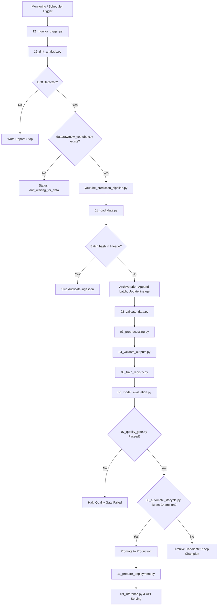

# YouTube Trending Video Views Prediction – End-to-End MLOps Platform

An end-to-end Machine Learning Operations (MLOps) platform for predicting YouTube trending video views, completely integrated across Labs 3–13.

The system features schema validation, reproducible preprocessing, MLflow experiment tracking and model registration, recall/R² quality gates, automated lifecycle management, fault-tolerance failure injection, FastAPI serving, Docker containerization, Kubernetes deployment specs, and drift monitoring with automated retraining triggers.

---

## Table of Contents
- [Project Overview](#project-overview)
- [Architecture](#architecture)
- [MLOps Pipeline Stages (Labs 7–13)](#mlops-pipeline-stages-labs-713)
- [Model Serving and API Engineering (Lab 10)](#model-serving-and-api-engineering-lab-10)
- [Drift Monitoring & Automated Retraining (Labs 12–13)](#drift-monitoring--automated-retraining-labs-1213)
- [Running the System](#running-the-system)
- [VS Code Integration](#vs-code-integration)

---

## Project Overview

Trending YouTube video views are heavily right-skewed and modeled as `log1p(views)`. Predictions are converted back using `expm1`. All stages evaluate and report metrics on both the log scale (`log_r2`, `log_mae`, `log_rmse`) and the original views scale (`r2`, `mae`, `rmse`).

Central design principles:
- **Reproducible data loading and lineage**: Raw files and incoming batches are tracked by SHA-256 hashes in `data/raw/archive/dataset_lineage.json`.
- **Quality-Gated Promotion**: A newly trained model must pass the quality gate (`log_r2 >= 0.65`) and outperform the active Production champion before deployment.
- **Fail-Fast Schema Validation**: Corrupt records or invalid values are rejected before reaching downstream stages.
- **Continuous Monitoring**: Automatic detection of data drift, prediction drift, and concept drift triggers conditional retraining only when new valid data is available.

---

## Architecture



---

## MLOps Pipeline Stages (Labs 7–13)

| Stage | Script | Purpose |
|---|---|---|
| 01 | `01_load_data.py` | Ingests new batches, computes SHA-256 hash, updates lineage, archives previous snapshots |
| 02 | `02_validate_data.py` | Validates raw video schema using Pandera |
| 03 | `03_preprocessing.py` | Engineers date parts, trending duration, text metrics; fits standard scaler & imputer |
| 04 | `04_validate_outputs.py` | Verifies transformed matrix dimensions, checks for NaNs and finite targets |
| 05 | `05_train_registry.py` | Trains tuned Random Forest model and registers under `YouTube_Views_Production_Model` |
| 06 | `06_model_evaluation.py` | Computes dual-scale regression metrics and saves `actual_vs_predicted.png` |
| 07 | `07_quality_gate.py` | Asserts `log_r2 >= 0.65`; halts deployment on quality regression |
| 08 | `08_automate_lifecycle.py` | Moves candidate to Staging, compares against Production champion, updates registry |
| 09 | `deploy_if_promoted.py` | Bundles deployment artifacts (`model.pkl`, `preprocessor.pkl`, `model_metadata.json`) |
| 10 | `09_inference.py` | Runs batch production inference and outputs `outputs/inference_predictions.csv` |

---

## Model Serving and API Engineering (Lab 10)

The FastAPI application in `api/` provides:
- `GET /` — API service details
- `GET /health` — Health check verifying model and preprocessor are loaded
- `GET /metadata` — Active model name, version, and target details
- `POST /predict` — Real-time single video views prediction
- `POST /predict/batch` — Bulk predictions with latency tracking

### Test the API
```powershell
# Run API test suite
pytest tests/test_api.py tests/test_performance.py

# Launch FastAPI server locally
uvicorn api.main:app --reload --port 8000
```

---

## Drift Monitoring & Automated Retraining (Labs 12–13)

- **Data Drift (`12_data_drift.py`)**: Two-sample Kolmogorov-Smirnov tests across `days_to_trending`, `title_length`, `description_length`, `publish_hour`, and `tag_count`.
- **Prediction Drift (`12_prediction_drift.py`)**: Tests predicted probability and log-views distributions between baseline and incoming inference data.
- **Concept Drift (`12_concept_drift.py`)**: Evaluates ground-truth metric degradation on labeled evolved samples.
- **Combined Analysis (`12_drift_analysis.py`)**: Aggregates all reports into `outputs/drift/drift_analysis_report.csv`.
- **Monitoring Trigger (`12_monitor_trigger.py`)**: Connects drift reports to the retraining orchestrator.

---

## Running the System

Ensure the virtual environment is active:
```powershell
.\venv\Scripts\Activate.ps1
```

### Run the full pipeline unconditionally:
```powershell
python src/mlops_pipeline/youtube_prediction_pipeline.py --force
```

### Run monitoring trigger:
```powershell
python src/mlops_pipeline/12_monitor_trigger.py
```

### Launch MLflow UI:
```powershell
mlflow ui --port 5000
```

---

## VS Code Integration

Use **Run and Debug** (**Ctrl + Shift + D**) or **Terminal > Run Task...**:
- `MLOps: Run Full Pipeline (--force)`
- `MLOps: Run Monitoring Trigger (Lab 13)`
- `MLOps: Run Pytest Test Suite`
- `API: Start FastAPI Server (Uvicorn)`
- `MLflow: Launch MLflow UI`
